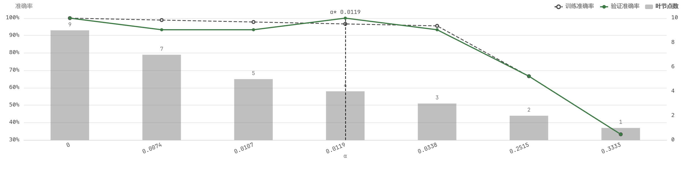
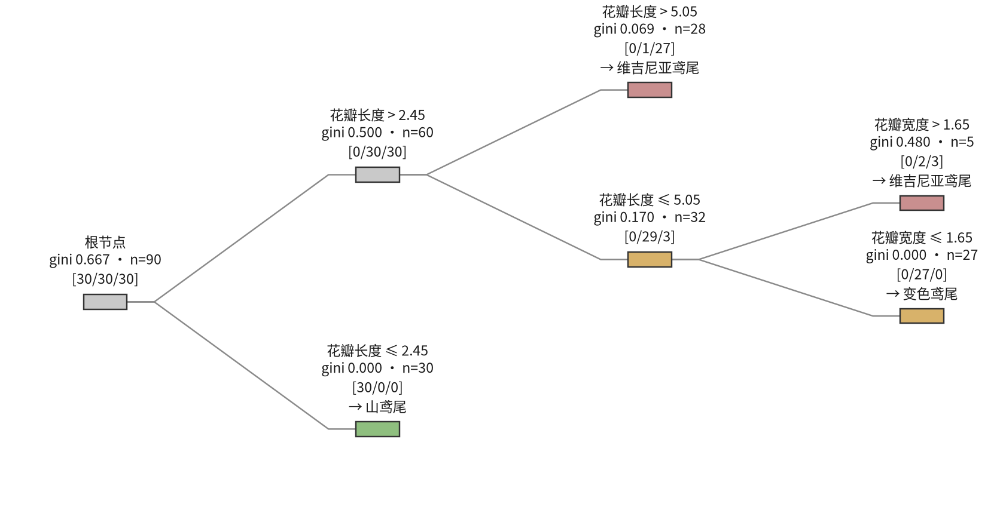
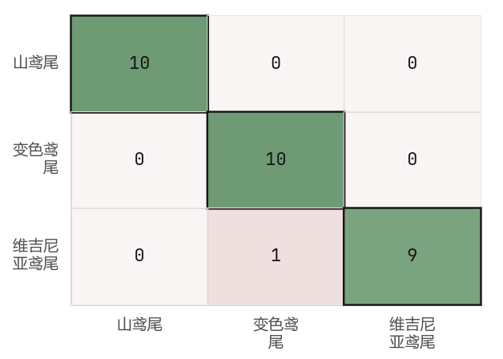
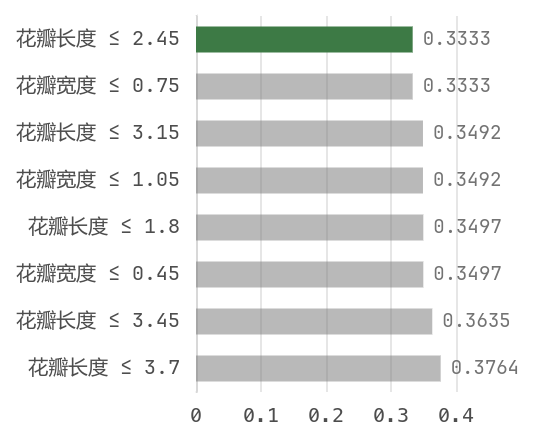
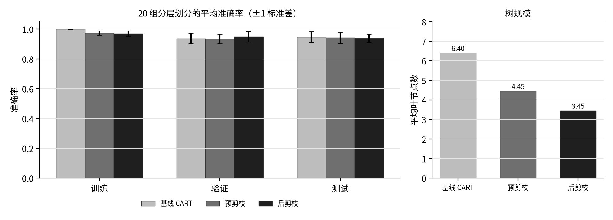
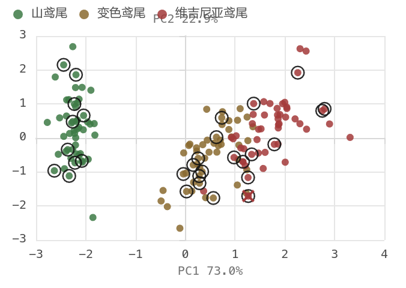
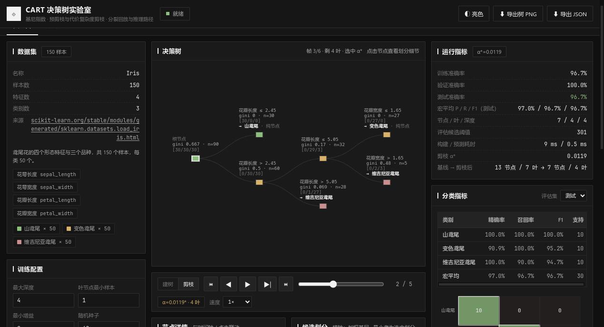

# 基于 CART 决策树的鸢尾花分类器设计与实现

**手写 Gini 分裂搜索 · 代价复杂度后剪枝 · 分裂过程可视化**

## 摘要

本实验用 NumPy 手写 CART 分类树，在 Iris 数据集上完成训练、剪枝、评估与推理路径分析。实现包含三部分：基于类别计数前缀和的快速阈值搜索、带停止条件的递归建树、以及代价复杂度（CCP）后剪枝。程序记录每个节点的候选划分与建树帧序列，可回放树的生成过程并查看单样本的逐节点判定。实验在 20 组分层划分上比较基线、预剪枝与后剪枝三种模型，分析树复杂度与泛化表现的关系。

## 1　任务与目标

1. 不调用现成决策树实现，手写 CART 的 Gini 计算、阈值搜索与递归建树。
2. 记录每次分裂的候选划分、Gini 变化与选择的特征阈值。
3. 实现后剪枝并与基线模型对比叶节点数、深度与准确率。
4. 基于混淆矩阵给出准确率、精确率、召回率，并分析测试样本的推理路径。
5. 交付可离线运行的桌面程序、决策树可视化与实验报告。

## 2　数据集与划分

数据为 scikit-learn 提供的 Iris 数据集副本：150 个样本、4 个连续特征、3 个类别，每类 50 个。特征为花萼长度、花萼宽度、花瓣长度、花瓣宽度（cm），类别为 setosa、versicolor、virginica。

按类别分层打乱后切分为训练集 60%、验证集 20%、测试集 20%，默认随机种子 42，得到 90/30/30，每类为 30/10/10。验证集用于选择剪枝参数 α，测试集只在最终评估时使用。划分函数对同一种子完全可复现。

## 3　CART 决策树实现

### 3.1　Gini 指数

节点不纯度用 Gini 指数衡量：

<div class="formula">Gini(D) = 1 − Σ<sub>k</sub> p<sub>k</sub>²</div>

候选划分的优劣用左右子集按样本数加权的 Gini 评价：

<div class="formula">Gini<sub>split</sub> = (|D<sub>L</sub>| / |D|) · Gini(D<sub>L</sub>) + (|D<sub>R</sub>| / |D|) · Gini(D<sub>R</sub>)</div>

划分增益为父节点 Gini 与加权 Gini 之差。选择增益最大的划分等价于选择加权 Gini 最小的划分。

### 3.2　候选阈值与快速搜索

连续特征的候选阈值取排序后相邻不同取值的中点：

<div class="formula">t<sub>i</sub> = (x<sub>(i)</sub> + x<sub>(i+1)</sub>) / 2,  x<sub>(i)</sub> ≠ x<sub>(i+1)</sub></div>

实现时每个特征只排序一次，从左向右扫描并用类别计数的前缀和增量更新左右分布。单节点复杂度为 O(F·n log n + F·n·K)，其中 F 为特征数、K 为类别数，避免了对每个阈值重新统计类别。训练集根节点（90 个样本、4 个特征）共评估 104 个候选阈值，整棵树累计评估 301 个。

对每个节点保留按加权 Gini 排序的前 8 个候选划分，供界面展示与报告分析。候选排序与最终选择都使用 `(加权 Gini, 特征下标, 阈值)` 作为稳定的平局规则。

### 3.3　递归建树与停止条件

节点在以下任一条件满足时成为叶节点：

| 停止条件 | 说明 |
|:--|:--|
| 节点纯净 | 只剩一个类别，Gini = 0 |
| 达到最大深度 | `max_depth` 限制 |
| 样本不足 | 样本数小于 `min_samples_split` |
| 无有效划分 | 没有满足 `min_samples_leaf` 的阈值 |
| 增益不足 | 最优划分的增益不超过 `min_gain` |

叶节点的预测类别取该节点内样本数最多的类别，平局取类别下标较小者。

以根节点为例：90 个样本三类各 30 个，Gini = 0.6667。候选划分中最优的两个是 `petal_length ≤ 2.45` 与 `petal_width ≤ 0.75`，加权 Gini 同为 0.3333；按平局规则选择特征下标较小的花瓣长度。该划分把 30 个 setosa 完全分离到左子节点。

### 3.4　节点记录与推理路径

每个节点保存编号、深度、样本数、类别计数、Gini、预测类别，以及分裂特征、阈值、增益和左右子节点编号。建树过程按「选择划分 → 递归左子树 → 递归右子树」的顺序记录帧，每帧附带当前树的快照，用于回放。

`explain()` 从根节点开始，按 `x[feature] ≤ threshold` 判断走向，逐步返回节点 Gini、类别计数、比较值与判定方向，直到叶节点给出预测类别。

## 4　优化：代价复杂度后剪枝

前剪枝通过深度与叶样本数限制树的规模，但阈值需要预先设定。本实验进一步实现代价复杂度后剪枝：先长成完整树，再自底向上合并子树。

定义子树风险为各叶节点不纯度按样本比例加权之和：

<div class="formula">R(T) = Σ<sub>leaf</sub> (n<sub>leaf</sub> / n<sub>root</sub>) · Gini(leaf)</div>

带复杂度惩罚的目标为：

<div class="formula">R<sub>α</sub>(T) = R(T) + α · |T<sub>leaf</sub>|</div>

对每个内部节点 t，弱链接系数为

<div class="formula">α<sub>eff</sub>(t) = (R(t) − R(T<sub>t</sub>)) / (|T<sub>t</sub>| − 1)</div>

每轮剪掉 α<sub>eff</sub> 最小的子树，得到 α 递增的一串树。程序在验证集上选择准确率最高的 α；若准确率相同，取叶节点更少的一棵。

种子 42 的剪枝序列：

| α | 叶节点 | 深度 | 合并的子树根 | 训练准确率 | 验证准确率 |
|--:|--:|--:|--:|--:|--:|
| 0 | 7 | 5 | — | 0.989 | 0.933 |
| 0.0107 | 5 | 4 | #6 | 0.978 | 0.933 |
| 0.0119 | 4 | 4 | #12 | 0.967 | 1.000 |
| 0.0338 | 3 | 3 | #5 | 0.956 | 0.933 |
| 0.2515 | 2 | 2 | #2 | 0.667 | 0.667 |
| 0.3333 | 1 | 1 | #0 | 0.333 | 0.333 |



图 4　α 与验证准确率、叶节点数的关系。虚线为训练准确率，实线为验证准确率。

验证集在 α = 0.0119 时达到 1.000，因此选择 4 个叶节点的模型。α 继续增大时模型退化为过度简化，训练与验证准确率同时下降。

## 5　实验设置

- 单次演示：随机种子 42，`max_depth=4`，`min_samples_leaf=1`，启用后剪枝。
- 稳定性实验：种子 0–19，共 20 组分层划分，比较三种模型：
  1. 基线 CART：不限制深度，长到节点纯净；
  2. 预剪枝：`max_depth=3`、`min_samples_leaf=2`；
  3. 后剪枝：完整树 + 验证集选择 α。
- 指标：准确率、每类精确率/召回率/F1、宏平均，以及混淆矩阵。
- 同时记录节点数、叶节点数、深度、候选阈值评估次数与训练/预测耗时。

## 6　实验结果

### 6.1　单次运行的模型与指标

种子 42 的基线树有 13 个节点、7 个叶节点、深度 5；剪枝后为 7 个节点、4 个叶节点、深度 4。训练耗时约 7–14 ms（随机器负载波动），测试集预测耗时不足 1 ms。

| 数据集 | 准确率 | 正确/总数 |
|:--|--:|--:|
| 训练集 | 0.967 | 87/90 |
| 验证集 | 1.000 | 30/30 |
| 测试集 | 0.967 | 29/30 |

测试集混淆矩阵：

| 真实 \ 预测 | setosa | versicolor | virginica |
|:--|--:|--:|--:|
| setosa | 10 | 0 | 0 |
| versicolor | 0 | 10 | 0 |
| virginica | 0 | 1 | 9 |

分类指标：

| 类别 | 精确率 | 召回率 | F1 | 支持数 |
|:--|--:|--:|--:|--:|
| setosa | 1.000 | 1.000 | 1.000 | 10 |
| versicolor | 0.909 | 1.000 | 0.952 | 10 |
| virginica | 1.000 | 0.900 | 0.947 | 10 |
| 宏平均 | 0.970 | 0.967 | 0.966 | 30 |



图 1　种子 42 的剪枝后决策树。节点上方标注进入条件、Gini、样本数与三类计数，颜色为多数类别。



图 2　测试集混淆矩阵。唯一错误为 1 个 virginica 被判为 versicolor。

唯一错误是把一个 virginica 判为 versicolor：该样本的花瓣长度为 5.0 cm、花瓣宽度 1.5 cm，落在 `petal_length ≤ 5.05` 且 `petal_width ≤ 1.65` 的叶节点内，该叶节点 27 个训练样本全部为 versicolor。

### 6.2　分裂节点的选择过程

根节点 90 个样本，Gini = 0.6667，共评估 104 个候选阈值。前五个候选：

| 特征 | 阈值 | 加权 Gini | 增益 | 左/右样本 |
|:--|--:|--:|--:|:--|
| petal_length | 2.45 | 0.3333 | 0.3333 | 30 / 60 |
| petal_width | 0.75 | 0.3333 | 0.3333 | 30 / 60 |
| petal_length | 3.15 | 0.3492 | 0.3175 | 31 / 59 |
| petal_width | 1.05 | 0.3492 | 0.3175 | 31 / 59 |
| petal_length | 1.80 | 0.3497 | 0.3169 | 29 / 61 |



图 3　根节点的候选划分。横轴为加权 Gini，数值越小越优，绿色为最终选择。

前两个候选的实际划分完全相同，都是把 30 个 setosa 与其余样本分开，因此加权 Gini 相同。程序按平局规则选择花瓣长度，界面上把两个候选都列出，便于观察这一现象。

右子节点含 60 个样本（versicolor 与 virginica 各 30），Gini = 0.5，最优划分为 `petal_length ≤ 5.05`，加权 Gini 降到 0.123，增益 0.377。该划分把 28 个以 virginica 为主的样本（27 个 virginica、1 个 versicolor）与 32 个混合样本分开。

第三层对 32 个样本（29 个 versicolor、3 个 virginica）选择 `petal_width ≤ 1.65`，加权 Gini 由 0.170 降到 0.075，分离出 5 个混合样本（2 个 versicolor、3 个 virginica）。该子节点 #12 在 α = 0.0119 时被合并为叶节点，验证集准确率由 0.933 提升到 1.000。

### 6.3　测试样本的推理路径

程序对每个类别选取一个测试样本，并额外加入被错分的样本，逐节点输出判定过程：

| 样本 | 真实类别 | 路径 | 预测 |
|--:|:--|:--|:--|
| 0 | setosa | 花瓣长度 1.4 ≤ 2.45 → 叶（Gini 0，30 个样本） | setosa |
| 51 | versicolor | 花瓣长度 4.5 > 2.45 → 花瓣长度 4.5 ≤ 5.05 → 花瓣宽度 1.5 ≤ 1.65 → 叶（27 个 versicolor） | versicolor |
| 101 | virginica | 花瓣长度 5.1 > 2.45 → 花瓣长度 5.1 > 5.05 → 叶（28 个样本，Gini 0.069） | virginica |
| 119 | virginica | 花瓣长度 5.0 > 2.45 → ≤ 5.05 → 花瓣宽度 1.5 ≤ 1.65 → 叶（27 个 versicolor） | versicolor（错分） |

样本 119 的错误来自花瓣长度的边界：5.0 cm 低于阈值 5.05，与多数 versicolor 落在同一区间。这说明单一阈值对相邻类别的可分性有限，也解释了后剪枝保留 3 个 virginica 混合样本的叶节点（#12）会带来更高验证准确率的原因。

### 6.4　20 组划分的稳定性

| 模型 | 训练准确率 | 验证准确率 | 测试准确率 | 平均叶节点 |
|:--|--:|--:|--:|--:|
| 基线 CART | 1.000 ± 0.000 | 0.938 ± 0.035 | 0.947 ± 0.036 | 6.4 |
| 预剪枝 | 0.974 ± 0.015 | 0.935 ± 0.032 | 0.943 ± 0.038 | 4.45 |
| 后剪枝（CCP） | 0.971 ± 0.017 | 0.950 ± 0.034 | 0.940 ± 0.029 | 3.45 |

结果表明：

1. 基线树在训练集上完全拟合，测试准确率均值 0.947。
2. 后剪枝把平均叶节点数从 6.4 降到 3.45，减少约 46%，验证准确率均值由 0.938 提升到 0.950。
3. 后剪枝的测试准确率均值 0.940，略低于基线 0.947，但标准差从 0.036 降到 0.029。测试集只有 30 个样本，单个样本对应 0.033 的准确率变化，该差异在一个样本以内。
4. 预剪枝的树规模介于两者之间，验证与测试表现均未超过后剪枝。



图 5　20 组分层划分的平均准确率（±1 个标准差）与平均叶节点数。

后剪枝的作用体现在复杂度与稳定性上：用更小的树获得相近的泛化准确率，并降低不同划分之间的波动。它不保证提高测试准确率，α 过大会导致欠拟合（α = 0.2515 时训练与验证准确率降到 0.667）。

## 7　可视化与系统实现

程序分为四层：`algorithms/` 实现 CART 与剪枝，`core/` 负责数据、PCA、指标，`app/` 组织训练与序列化，`frontend/` 用原生 JavaScript 与 ECharts 渲染。

- 决策树：正交布局，节点显示 Gini、样本数与三类计数，边上的标签为分裂条件，颜色取多数类别，选中节点高亮。
- 建树回放：时间轴逐帧播放「选择划分 → 展开子树 → 生成叶节点」，当前帧的树快照与候选划分表同步更新。
- 候选划分：横向柱状图按加权 Gini 排序显示节点评估过的前 8 个候选，选中项高亮，悬停显示增益与左右样本数。
- 混淆矩阵：3×3 热力图，标注计数并突出对角线。
- 剪枝曲线：横轴为 α，纵轴同时给出训练/验证准确率与叶节点数。
- 推理路径：从测试样本列表中选择样本，逐节点显示比较条件、Gini、类别计数与最终预测。
- 主题：深色与浅色可切换，图表颜色读取 CSS 变量后重绘。



图 6　Iris 的 PCA 二维投影。圆点为训练/验证样本，方框为测试样本，叉号为错分样本。



图 7　程序主界面：决策树、建树时间轴、节点候选划分、指标与混淆矩阵。

前后端通过 pywebview 的单个 API 对象通信，算法结果序列化为 JSON，界面不重复计算。ECharts 与数据集随程序分发，无需网络。Linux 使用 Qt WebEngine；跨平台启动逻辑与打包配置预留了 Windows 的 Edge WebView2 分支。

## 8　结论

1. 手写 CART 在 Iris 上达到 0.967 的测试准确率（种子 42），四个花瓣与花萼特征足以区分三类。
2. 排序扫描与前缀计数把单节点阈值搜索控制在 O(F·n log n + F·n·K)，整棵树仅评估 301 个候选阈值。
3. 代价复杂度后剪枝在 20 组划分上把叶节点数从 6.4 降到 3.45，验证准确率由 0.938 提升到 0.950，测试准确率保持在同一水平（0.940），且波动更小。
4. 分裂分析显示：根节点用花瓣长度 2.45 分离 setosa；第二层用 5.05 区分 versicolor 与 virginica；剩余混合样本由花瓣宽度 1.65 处理。误分样本集中在花瓣长度 5.0 cm 附近的边界区域。
5. 界面同时提供树结构、候选划分、混淆矩阵、剪枝曲线与逐样本推理路径，可用于课堂演示与结果复核。

## 附：复现方式

```sh
uv run --locked pytest -q
uv run --locked python scripts/run_experiments.py ./experiment_results
```

测试覆盖 Gini 计算、阈值搜索与暴力枚举的一致性、停止条件、叶样本数约束、推理路径一致性、剪枝序列单调性、混淆矩阵与指标计算，以及数据规模与划分。演示使用种子 42；20 组种子的逐次结果保存在 `03_TestSamples/expected_results/`。
